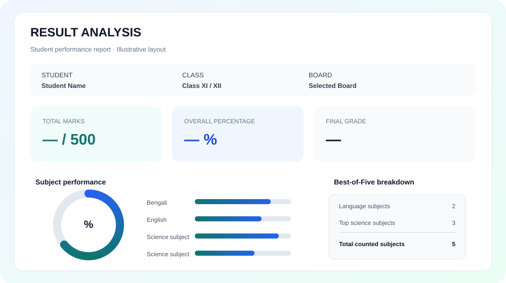

<div align="center">


**A lightweight academic result calculator for Class XI–XII science students.**

[Overview](#overview) · [Features](#features) · [Workflow](#how-it-works) · [Setup](#run-locally) · [Structure](#project-structure)


</div>

---

## Overview

**Result Analysis** is a browser-based result calculator designed for students in the science stream of Classes XI and XII. Students can enter their academic details and subject marks, calculate a Best-of-Five result, and view a clear performance report.

The application is built with **HTML, CSS, and vanilla JavaScript**. It does not currently require a backend or database; form data is passed between pages using the browser's `localStorage`.

> **Note:** This is an independent estimation tool. The grade labels and calculation rules reflect the current application code. They are not official board-issued results or a replacement for institutional grading rules.

## Features

| Feature | Description |
| --- | --- |
| Student details | Collects name, class, and education board. |
| Subject marks | Accepts marks for Bengali, English, Physics, Chemistry, Mathematics, and Biology. |
| Input constraints | Requires marks between 0 and 100 for each subject. |
| Best-of-Five | Includes Bengali, English, and the three highest-ranked science subjects. |
| Optional preference | Uses the selected optional subject as a tie-break preference when science subjects have equal marks. |
| Grade and remarks | Displays application-defined grades and performance remarks. |
| Visual analytics | Animated score ring, grade-scale ladder, Best-5 bars, six-subject column chart, strength radar, share-of-total donut and quick insights. |
| Printable report | Opens the browser print dialog; a dedicated A4 print layout keeps every card and chart uncut in the saved PDF. |
| Responsive design | Dark, animated UI with SVG icons; the result table turns into compact cards on phones. |

## How it works

The project has two main pages:

1. **Input — `index.html`:** students enter their details, board, marks, and optional-subject preference.
2. **Report — `result.html`:** JavaScript reads the stored data, calculates the summary, and renders the report.



### Best-of-Five calculation

The current implementation follows this logic:

- Bengali and English are always included.
- Physics, Chemistry, Mathematics, and Biology are sorted by marks in descending order.
- The top three science subjects are included in the total.
- The remaining science subject is displayed as the optional subject.
- If science subjects have equal marks, the selected optional-subject preference is used to place that subject after the tied alternatives.

```text
Bengali + English + Top 3 science subjects
                  |
                  v
           Total out of 500
                  |
                  v
       Overall percentage and grade
```

Each subject percentage is its marks out of 100. Overall percentage is calculated from the Best-of-Five total out of 500.

### Current grade scale

These thresholds are defined in `result.js`:

| Marks / Percentage | Grade | Remark |
| ---: | :---: | --- |
| 90–100 | A+ | Outstanding |
| 80–89 | A | Excellent |
| 60–79 | B+ | Very Good |
| 45–59 | B | Good |
| 25–44 | C | Pass |
| Below 25 | D | Fail |

These are application-defined thresholds, not an official grading policy.

## Interface preview

The following SVG is an illustrative report layout for documentation; it is not a live screenshot.



## Technology stack

<p>


</p>

| Technology | Purpose |
| --- | --- |
| HTML5 | Form and report structure |
| CSS3 | Styling, responsive table, and print styles |
| Vanilla JavaScript | Input handling, calculations, and DOM updates |
| Browser localStorage | Temporary data transfer between pages |
| Inline SVG | Lightweight charts and icons (no chart library, works offline) |

## Run locally

No package installation or build step is required.

1. Clone the repository:

   ```bash
   git clone https://github.com/duttaanubhab777-code/Result-Analysis.git
   ```

2. Open the project directory:

   ```bash
   cd Result-Analysis
   ```

3. Open `index.html` in a modern web browser.
4. Fill in the form and submit it to view the generated report.

You can also use a code editor's static live-preview or local-server feature.

## Project structure

```text
Result-Analysis/
├── index.html          # Student details and marks form
├── script.js           # Form handling and localStorage hand-off
├── form-ui.js          # Form completion progress (UI only)
├── result.html         # Result report structure
├── result.js           # Best-of-Five logic and grade calculation
├── analytics.js        # SVG charts, table polish, print preparation (UI only)
├── theme.css           # Shared design tokens and base styles
├── style.css           # Form page styles
├── resultstyle.css     # Report, responsive and A4 print styles
├── assets/
│   ├── workflow.svg    # Workflow diagram
│   └── report-preview.svg
└── README.md
```

## Data and privacy

- Submitted form data is stored in the browser's `localStorage` using the key `resultData`.
- The current version does not configure an application backend or database.
- Data remains in the browser until it is overwritten or cleared by the user or browser.
- Avoid entering sensitive personal information.

## Print or save as PDF

On the result page, select **Download Result** to open the browser's print dialog. Choose a printer or the **Save as PDF** destination, if available.

## Roadmap

Potential improvements for future versions:

- [ ] Replace browser alerts with accessible inline validation messages.
- [ ] Improve keyboard navigation and screen-reader support.
- [ ] Add a dedicated, polished print stylesheet.
- [ ] Make grading rules configurable by board or institution.
- [ ] Add automated tests for calculation and tie-breaking logic.
- [ ] Add an option to clear saved result data.

## Contributing

Bug reports, ideas, and improvements are welcome.

1. Fork the repository.
2. Create a branch: `git checkout -b feature/your-change`.
3. Make and test your changes in a browser.
4. Commit: `git commit -m "Describe your change"`.
5. Push your branch and open a pull request.

Please keep documentation and feature claims aligned with the actual implementation.

## License

The project is intended to use the **MIT License**. Refer to the repository's license file for the applicable terms.

## Author

**Anubhab Dutta**

<div align="center">
<sub>Built to make academic result calculations easier to understand.</sub>

</div>
